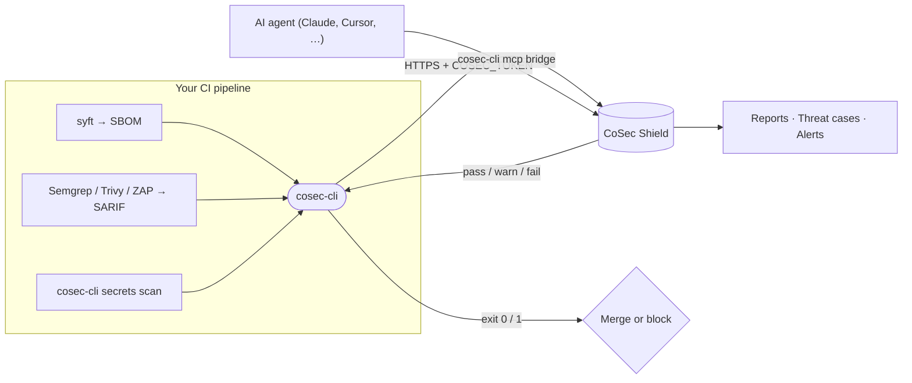
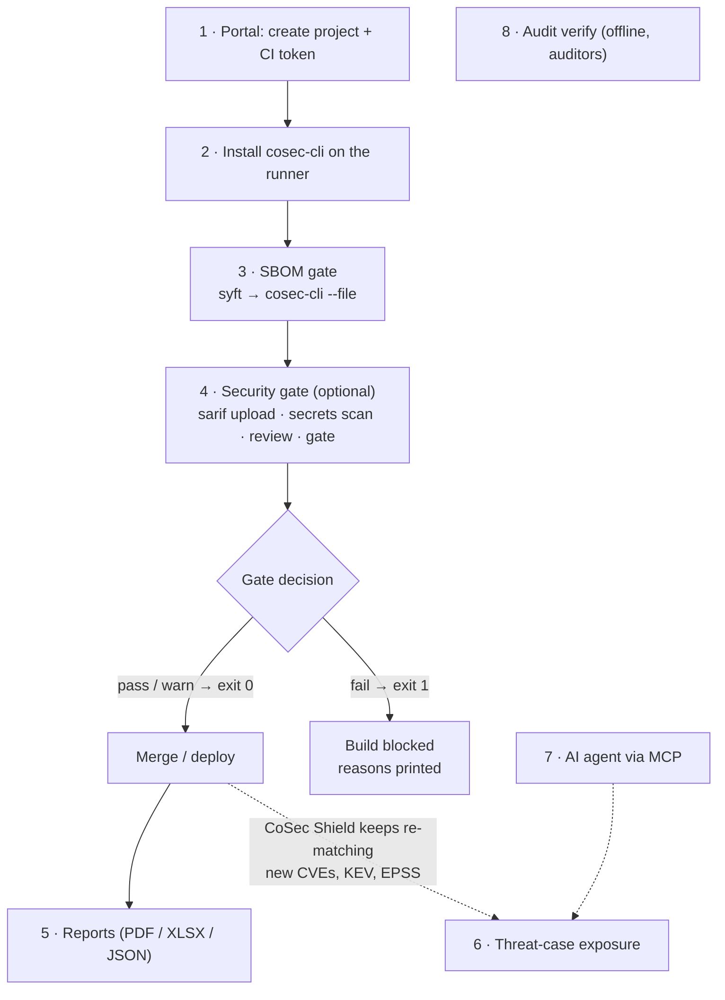
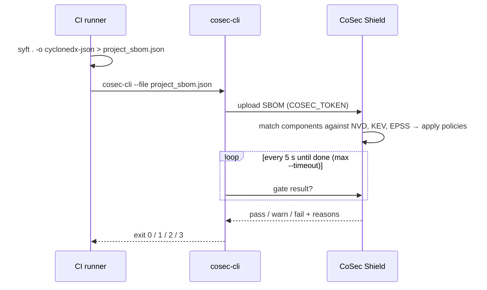
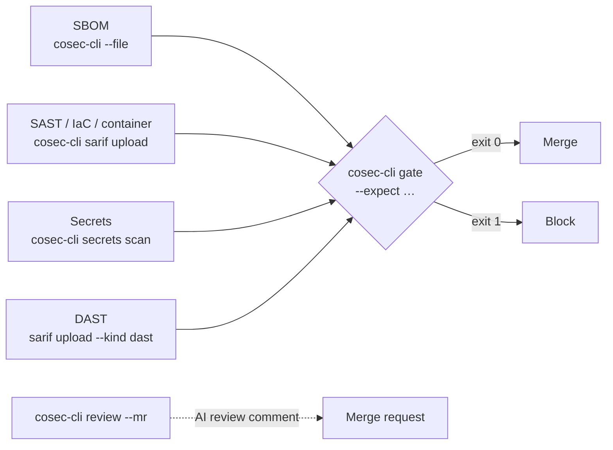
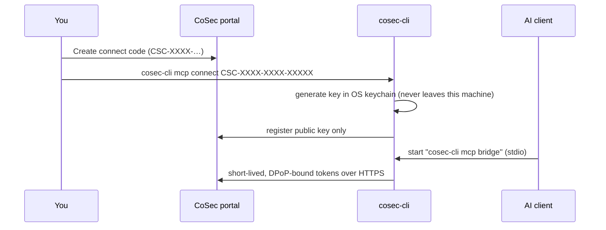

# cosec-cli

[ภาษาไทย](README.th.md) · [Releases](https://github.com/epicprosmart-info/cosec-cli/releases) · [CI guide](https://cosec-shield.epicprosmart.com/#/help/ci) · [Security](SECURITY.md) · [License](LICENSE.md)

Command-line client for [CoSec Shield](https://cosec-shield.epicprosmart.com): upload an SBOM from any CI and fail
the build when the project's gate says `fail`, inspect threat-case exposure (`case php2shell`), verify encrypted
audit files offline (`audit verify`), and connect an AI agent through the MCP bridge (`mcp connect`).

One static binary, no runtime, for **Linux, macOS and Windows** on amd64 and arm64. Latest release: **v1.0.0-rc.4**.

> This repository distributes **binaries only**. It contains no source code; the "Source code" archives GitHub
> attaches to every release hold nothing but the files on this page.

## At a glance



| I want to… | Command | Section |
|---|---|---|
| Block a build on vulnerable dependencies | `cosec-cli --file project_sbom.json` | [Step 3](#step-3--sbom-gate-dependencies) |
| Add SAST / secrets / DAST results to the gate | `cosec-cli sarif upload`, `secrets scan`, `gate` | [Step 4](#step-4--full-security-gate-optional) |
| Get an AI review on a merge request | `cosec-cli review --mr 12` | [Step 4](#step-4--full-security-gate-optional) |
| Download a PDF / XLSX report | `cosec-cli report` | [Step 5](#step-5--reports) |
| Check exposure to a known threat (e.g. PHP2Shell) | `cosec-cli case php2shell` | [Step 6](#step-6--threat-case-exposure) |
| Let an AI agent query CoSec Shield | `cosec-cli mcp connect` / `bridge` | [Step 7](#step-7--connect-an-ai-agent-mcp) |
| Prove audit logs were not tampered with | `cosec-cli audit verify` | [Step 8](#step-8--verify-audit-logs-offline) |

**Contents:** [Install](#install) · [Full workflow](#full-workflow) · [Command reference](#command-reference) ·
[Update](#update) · [Uninstall](#uninstall)

## Install

Every method below downloads the archive **and** `SHA256SUMS` from the same release and checks the sha256 before
anything is unpacked. Pick one per OS.

### macOS (12 or later, Apple Silicon and Intel)

**Homebrew**

```sh
brew install epicprosmart-info/tap/cosec-cli      # later: brew upgrade cosec-cli
```

**Install script** (download, read, run)

```sh
curl -fsSLO https://github.com/epicprosmart-info/cosec-cli/releases/latest/download/install.sh
sh install.sh                                    # pin: COSEC_CLI_VERSION=v1.0.0-rc.4 sh install.sh
```

**By hand**

```sh
V=v1.0.0-rc.4; B=https://github.com/epicprosmart-info/cosec-cli/releases/download/$V
curl -fsSLO "$B/cosec-cli_${V}_darwin_arm64.tar.gz" && curl -fsSLO "$B/SHA256SUMS"   # Intel: darwin_amd64
grep "_darwin_arm64.tar.gz$" SHA256SUMS | shasum -a 256 -c -
tar -xzf "cosec-cli_${V}_darwin_arm64.tar.gz" cosec-cli && sudo install -m 0755 cosec-cli /usr/local/bin/
cosec-cli --version
```

Only a file saved by a **browser** carries the quarantine flag; clear it with
`xattr -d com.apple.quarantine /usr/local/bin/cosec-cli`. Files from `curl`, Homebrew or the script do not need this.

### Windows (10 / Server 2016 or later, no administrator rights)

**Scoop**

```powershell
scoop bucket add epicprosmart-info https://github.com/epicprosmart-info/scoop-bucket
scoop install cosec-cli                          # later: scoop update cosec-cli
```

**Install script** (PowerShell 5.1 or 7; installs to `%LOCALAPPDATA%\Programs\cosec-cli` and adds it to your user PATH)

```powershell
Invoke-WebRequest https://github.com/epicprosmart-info/cosec-cli/releases/latest/download/install.ps1 -OutFile install.ps1
powershell -ExecutionPolicy Bypass -File .\install.ps1          # pin: -Version v1.0.0-rc.4
```

**By hand**

```powershell
$v = 'v1.0.0-rc.4'; $b = "https://github.com/epicprosmart-info/cosec-cli/releases/download/$v"
Invoke-WebRequest "$b/cosec-cli_${v}_windows_amd64.zip" -OutFile cosec-cli.zip      # ARM: windows_arm64
Invoke-WebRequest "$b/SHA256SUMS" -OutFile SHA256SUMS
$want = (Select-String -Path SHA256SUMS -Pattern '_windows_amd64\.zip$').Line.Split(' ')[0]
if ((Get-FileHash cosec-cli.zip -Algorithm SHA256).Hash.ToLower() -ne $want) { throw 'checksum mismatch' }
Expand-Archive cosec-cli.zip -DestinationPath "$env:LOCALAPPDATA\Programs\cosec-cli" -Force
$env:Path += ";$env:LOCALAPPDATA\Programs\cosec-cli"      # this window only; the script makes it permanent
cosec-cli --version
```

### Linux (any distribution, including Alpine)

**Install script** (POSIX `sh`; needs `curl` or `wget` and `tar`)

```sh
curl -fsSLO https://github.com/epicprosmart-info/cosec-cli/releases/latest/download/install.sh
sh install.sh                                    # pin: COSEC_CLI_VERSION=v1.0.0-rc.4 sh install.sh
```

The script installs to `/usr/local/bin` when that is writable, otherwise to `~/.local/bin`, and never calls
`sudo`. Set `COSEC_CLI_INSTALL_DIR` to choose, `COSEC_CLI_BASE_URL` to use an internal mirror.

**Package** (Debian/Ubuntu or RHEL/Fedora; installs `/usr/bin/cosec-cli`, no service, no dependencies)

```sh
V=v1.0.0-rc.4; B=https://github.com/epicprosmart-info/cosec-cli/releases/download/$V
curl -fsSLO "$B/cosec-cli_${V#v}_amd64.deb" && curl -fsSLO "$B/SHA256SUMS" && sha256sum -c --ignore-missing SHA256SUMS
sudo dpkg -i "cosec-cli_${V#v}_amd64.deb"       # RHEL / Fedora: sudo rpm -i cosec-cli_${V#v}_amd64.rpm
```

**By hand** (also for Dockerfiles and runner images: pinned version, static layer)

```sh
V=v1.0.0-rc.4; B=https://github.com/epicprosmart-info/cosec-cli/releases/download/$V
curl -fsSLO "$B/cosec-cli_${V}_linux_amd64.tar.gz" && curl -fsSLO "$B/SHA256SUMS"   # ARM: linux_arm64
sha256sum -c --ignore-missing SHA256SUMS
tar -xzf "cosec-cli_${V}_linux_amd64.tar.gz" cosec-cli && sudo install -m 0755 cosec-cli /usr/local/bin/
cosec-cli --version
```

## Verify a release

| File | What it is |
|---|---|
| `cosec-cli_<tag>_<os>_<arch>.tar.gz` / `.zip` | one binary, `cosec-cli` or `cosec-cli.exe`, at the archive root |
| `cosec-cli_<x.y.z>_<arch>.deb` / `.rpm` | the same Linux binary as a package |
| `*.cdx.json` | CycloneDX SBOM of each binary |
| `SHA256SUMS` | sha256 of every file above, plus the install scripts |
| `SHA256SUMS.sig` | cosign signature of `SHA256SUMS` (attached once releases are signed; key: [`cosign.pub`](cosign.pub)) |
| `install.sh`, `install.ps1` | the scripts above, exactly as on `main` at this tag |
| `release.json` | machine-readable list of the files with sha256 and URLs |

```sh
sha256sum -c --ignore-missing SHA256SUMS                                   # macOS: shasum -a 256 -c
cosign verify-blob --key cosign.pub --signature SHA256SUMS.sig SHA256SUMS  # when SHA256SUMS.sig exists
```

A mismatch means a corrupted or tampered download: delete it, download again, and report a repeat as described in
[SECURITY.md](SECURITY.md).

## Full workflow



### Step 1 — Prepare CoSec Shield (once per project)

1. Sign in to [CoSec Shield](https://cosec-shield.epicprosmart.com) → **Projects → New project**. Copy the **project ID**
   (`01H…`) from the project's **CI integration** tab.
2. **Projects → your project → API tokens → New API token** with scopes `sbom:write` and `gate:read`. Copy the token (`cst_…`) — it is
   shown only once.
3. Store the token in your CI secret store as `COSEC_TOKEN`. Put `COSEC_URL` and `COSEC_PROJECT` in plain CI variables.

| Variable | Example | Notes |
|---|---|---|
| `COSEC_URL` | `https://cosec.example.com` | `https://` only; `http://` is refused except for localhost |
| `COSEC_PROJECT` | `01H…` | or `--project` |
| `COSEC_TOKEN` | `cst_…` | **secret**; read only from the environment, never a flag |

### Step 2 — Install cosec-cli

Use one of the methods in [Install](#install) and pin the version in runner images. On **GitHub Actions** you can skip
the binary and use the action: `epicprosmart-info/cosec-shield/.github/actions/cosec-gate@v1`.

### Step 3 — SBOM gate (dependencies)



```sh
export COSEC_URL=https://cosec.example.com COSEC_PROJECT=01H…    # COSEC_TOKEN comes from your CI secret store
syft . -o cyclonedx-json > project_sbom.json
cosec-cli --file project_sbom.json --commit "$(git rev-parse HEAD)" --timeout 5m
```

Useful flags: `--fail-on warn` (stricter), `--json` (raw gate result), `--runtime php=8.3.12 --sapi fpm` (declare the
runtime when the SBOM has none). `--commit`, `--build-id` and `--tag` are filled from GitHub / GitLab / Jenkins
variables automatically.

| Exit code | Meaning |
|:---:|---|
| 0 | gate `pass` (or `warn` without `--fail-on warn`) |
| 1 | gate `fail` |
| 2 | usage / upload error (the reasons are printed) |
| 3 | timed out waiting for the scan |

### Step 4 — Full security gate (optional)

Combine dependencies, code, secrets and DAST into **one decision per commit**:



```sh
C=$(git rev-parse HEAD)
cosec-cli --file project_sbom.json --commit "$C"
semgrep --sarif -o semgrep.sarif . && cosec-cli sarif upload --file semgrep.sarif --kind sast --commit "$C"
cosec-cli secrets scan --commit "$C"                 # runs pinned gitleaks 8.18.4, uploads as kind=secret
cosec-cli review --mr "$CI_MERGE_REQUEST_IID"         # optional: AI review of the merge request
cosec-cli gate --commit "$C" --expect sbom,sarif:sast,sarif:secret --timeout 10m
```

- `--kind` is one of `sast`, `secret`, `dast`, `iac`, `container`. Files above 1 MB are gzipped automatically.
- `secrets scan --history` scans the whole git history; `--gitleaks-sha256` checks the scanner binary before it runs.
- `gate --expect` lists the inputs the gate waits for; it uses the same exit codes as Step 3.

### Step 5 — Reports

```sh
cosec-cli report --type ASR --format pdf,xlsx --lang en --out ./reports      # scan report, latest scan
cosec-cli report --type PSR --format pdf                                     # project report (no --project = all)
```

Formats: `pdf`, `html`, `json`, `json_cx`, `csv`, `xlsx`. Options: `--profile cx|extended`,
`--group-by vulnerability_type|package|severity`, `--severity critical,high`, `--lang en|th`, `--sbom` / `--baseline`.
Exit 0 ok, 2 request error, 3 generation failed or timed out.

### Step 6 — Threat-case exposure

CoSec Shield keeps re-matching stored SBOMs when new CVEs, KEV entries or EPSS changes arrive — no new build needed.
To see whether a project is exposed to a tracked threat:

```sh
cosec-cli case php2shell            # add --json for machine-readable output; always exits 0
```

### Step 7 — Connect an AI agent (MCP)



```sh
cosec-cli mcp connect CSC-XXXX-XXXX-XXXXX     # once; prints the JSON to paste into your AI client
cosec-cli mcp status                          # check the connection
cosec-cli mcp rotate-key                      # new key; the old one stops working after 10 minutes
cosec-cli mcp disconnect                      # revoke and delete the local key
```

AI client config (Claude Desktop, Cursor, …):

```json
{ "mcpServers": { "cosec-shield": { "command": "cosec-cli", "args": ["mcp", "bridge"] } } }
```

Several organisations on one machine: add `--profile <name>` (or `COSEC_MCP_PROFILE`).

### Step 8 — Verify audit logs offline

For auditors: check the hash-chained, encrypted audit files without trusting the server.

```sh
cosec-cli audit verify --dir /var/lib/cosec/audit --manifests manifests.json --seal-pub seal1:BASE64
cosec-cli audit decrypt --bundle export.cae --kek-file kek.b64 --out records.jsonl
cosec-cli audit inspect --file 2026-10-31.cal
```

`manifests.json` comes from `GET /api/v1/audit-logs/manifests`. Exit 0 ok, 2 tampered, 3 missing / unsealed data,
4 usage or I/O error.

## Command reference

| Command | Purpose | Exit codes |
|---|---|---|
| `cosec-cli --file <sbom>` | upload SBOM, wait for the gate | 0 pass · 1 fail · 2 error · 3 timeout |
| `cosec-cli sarif upload --file f --kind k` | upload SAST / secret / DAST / IaC / container results | same |
| `cosec-cli secrets scan [--history]` | gitleaks → SARIF → upload | same |
| `cosec-cli review --mr <iid> [--wait]` | request an AI merge-request review | same |
| `cosec-cli gate --commit <sha> --expect …` | unified gate for one commit | same |
| `cosec-cli report [--type ASR\|PSR]` | generate and download reports | 0 ok · 2 error · 3 failed / timeout |
| `cosec-cli case <slug>` | threat-case exposure | 0 |
| `cosec-cli mcp connect\|bridge\|status\|rotate-key\|disconnect` | AI agent bridge | — |
| `cosec-cli audit inspect\|verify\|decrypt` | offline audit check | 0 ok · 2 tampered · 3 missing · 4 error |
| `cosec-cli update --check [--json]` | is a newer release out? | 0 · 2 error |
| `cosec-cli --version`, `cosec-cli -h` | version, help | 0 |

Every subcommand prints its own flags with `-h`. Ready-made snippets for GitLab, Jenkins, Azure Pipelines and
Bitbucket: [CI guide](https://cosec-shield.epicprosmart.com/#/help/ci).

## Update

```sh
cosec-cli update --check          # compares with the latest release here; prints the upgrade command for your OS
```

The check is the only network call `cosec-cli` ever makes on its own initiative, and only when you run it. The
binary never downloads or replaces itself. Upgrade with `brew upgrade cosec-cli`, `scoop update cosec-cli`, the
install script, or the new package.

## Uninstall

| Installed with | Remove |
|---|---|
| Homebrew | `brew uninstall cosec-cli` |
| Scoop | `scoop uninstall cosec-cli` |
| install.sh / by hand | `rm /usr/local/bin/cosec-cli` (or `~/.local/bin/cosec-cli`) |
| install.ps1 / by hand | delete `%LOCALAPPDATA%\Programs\cosec-cli` and remove it from your user PATH |
| deb / rpm | `sudo dpkg -r cosec-cli` / `sudo rpm -e cosec-cli` |

MCP profiles and keys live in `~/.config/cosec-cli/` and the OS keychain; `cosec-cli mcp disconnect` removes them.

## License

Proprietary binary license, see [LICENSE.md](LICENSE.md). Third-party components are listed in the SBOM attached
to each release.
