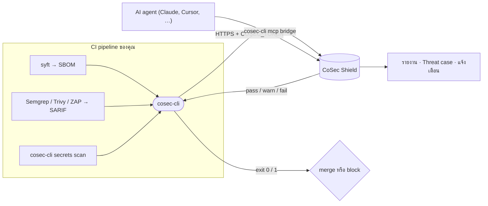
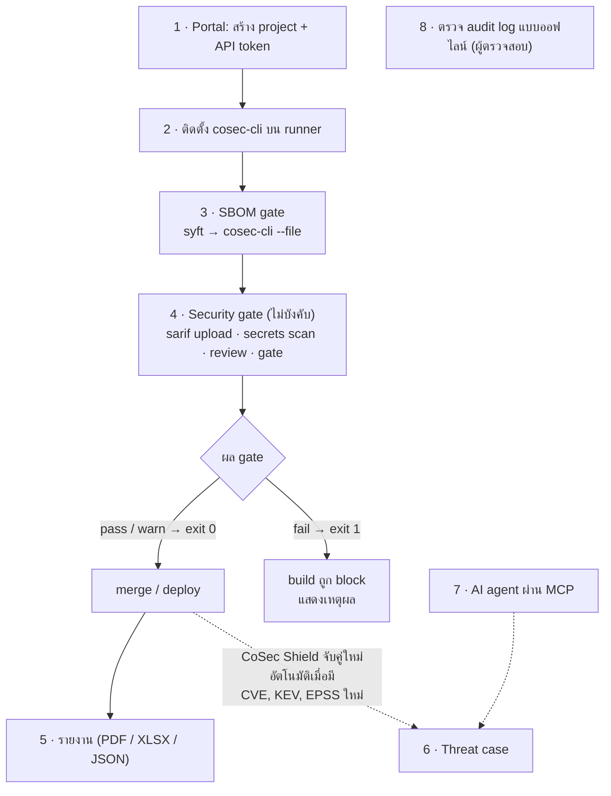
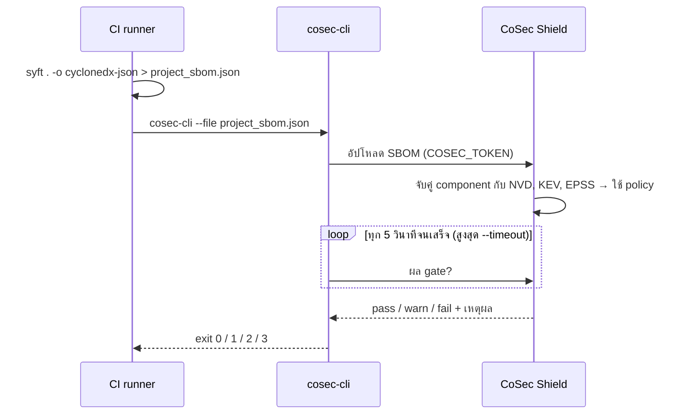
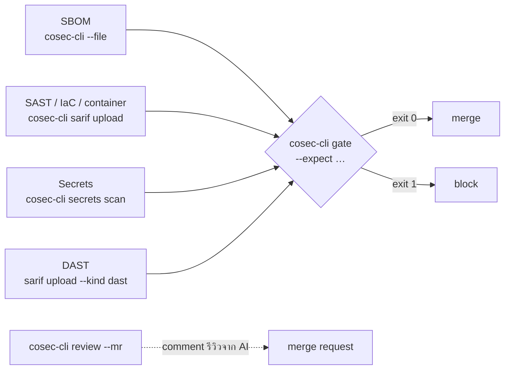
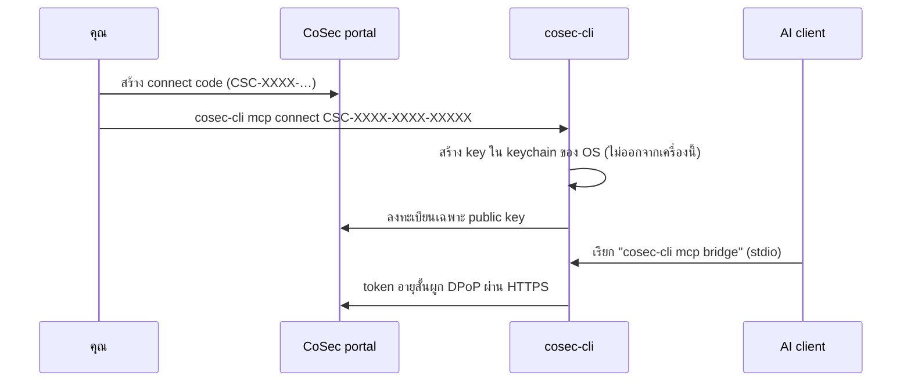

# cosec-cli

[English](README.md) · [Releases](https://github.com/epicprosmart-info/cosec-cli/releases) · [คู่มือ CI](https://cosec-shield.epicprosmart.com/#/help/ci) · [ความปลอดภัย](SECURITY.md) · [สัญญาอนุญาต](LICENSE.md)

เครื่องมือบรรทัดคำสั่งของ [CoSec Shield](https://cosec-shield.epicprosmart.com): อัปโหลด SBOM จาก CI ใดก็ได้แล้วให้ build
fail เมื่อ gate ของ project เป็น `fail`, ดูผลกระทบจาก threat case (`case php2shell`), ตรวจไฟล์ audit ที่เข้ารหัสแบบออฟไลน์
(`audit verify`) และเชื่อม AI agent ผ่าน MCP bridge (`mcp connect`)

binary เดียว static ไม่ต้องมี runtime สำหรับ **Linux, macOS และ Windows** ทั้ง amd64 และ arm64 — release ล่าสุด: **v1.0.0-rc.4**

> repository นี้แจก **binary เท่านั้น** ไม่มี source code; archive "Source code" ที่ GitHub แนบให้ทุก release โดยอัตโนมัติ
> มีแค่ไฟล์ที่เห็นในหน้านี้

## ภาพรวม



| ต้องการ… | คำสั่ง | ดูที่ |
|---|---|---|
| block build เมื่อ dependency มีช่องโหว่ | `cosec-cli --file project_sbom.json` | [ขั้นที่ 3](#th-step-3) |
| รวมผล SAST / secrets / DAST เข้า gate | `cosec-cli sarif upload`, `secrets scan`, `gate` | [ขั้นที่ 4](#th-step-4) |
| ให้ AI รีวิว merge request | `cosec-cli review --mr 12` | [ขั้นที่ 4](#th-step-4) |
| ดาวน์โหลดรายงาน PDF / XLSX | `cosec-cli report` | [ขั้นที่ 5](#th-step-5) |
| ดูว่าโดนภัยที่รู้จักหรือไม่ (เช่น PHP2Shell) | `cosec-cli case php2shell` | [ขั้นที่ 6](#th-step-6) |
| ให้ AI agent ค้นข้อมูลจาก CoSec Shield | `cosec-cli mcp connect` / `bridge` | [ขั้นที่ 7](#th-step-7) |
| พิสูจน์ว่า audit log ไม่ถูกแก้ไข | `cosec-cli audit verify` | [ขั้นที่ 8](#th-step-8) |

**สารบัญ:** [ติดตั้ง](#th-install) · [ขั้นตอนการใช้งานทั้งหมด](#th-workflow) · [สรุปคำสั่ง](#th-commands) ·
[อัปเดต](#th-update) · [ถอนการติดตั้ง](#th-uninstall)

<a id="th-install"></a>

## ติดตั้ง

ทุกวิธีด้านล่างดาวน์โหลด archive **และ** `SHA256SUMS` จาก release เดียวกัน แล้วตรวจ sha256 ก่อนแตกไฟล์เสมอ เลือกวิธีใดวิธีหนึ่งต่อ OS

### macOS (12 ขึ้นไป ทั้ง Apple Silicon และ Intel)

**Homebrew**

```sh
brew install epicprosmart-info/tap/cosec-cli      # อัปเกรดภายหลัง: brew upgrade cosec-cli
```

**สคริปต์ติดตั้ง** (ดาวน์โหลด → อ่าน → รัน)

```sh
curl -fsSLO https://github.com/epicprosmart-info/cosec-cli/releases/latest/download/install.sh
sh install.sh                                    # ระบุเวอร์ชัน: COSEC_CLI_VERSION=v1.0.0-rc.4 sh install.sh
```

**ด้วยมือ**

```sh
V=v1.0.0-rc.4; B=https://github.com/epicprosmart-info/cosec-cli/releases/download/$V
curl -fsSLO "$B/cosec-cli_${V}_darwin_arm64.tar.gz" && curl -fsSLO "$B/SHA256SUMS"   # Intel: darwin_amd64
grep "_darwin_arm64.tar.gz$" SHA256SUMS | shasum -a 256 -c -
tar -xzf "cosec-cli_${V}_darwin_arm64.tar.gz" cosec-cli && sudo install -m 0755 cosec-cli /usr/local/bin/
cosec-cli --version
```

เฉพาะไฟล์ที่บันทึกผ่าน **browser** จะติด quarantine ให้ลบด้วย `xattr -d com.apple.quarantine /usr/local/bin/cosec-cli`
ไฟล์จาก `curl`, Homebrew หรือสคริปต์ไม่ต้องทำ

### Windows (10 / Server 2016 ขึ้นไป ไม่ต้องใช้สิทธิ์ Administrator)

**Scoop**

```powershell
scoop bucket add epicprosmart-info https://github.com/epicprosmart-info/scoop-bucket
scoop install cosec-cli                          # อัปเกรดภายหลัง: scoop update cosec-cli
```

**สคริปต์ติดตั้ง** (PowerShell 5.1 หรือ 7; ติดตั้งลง `%LOCALAPPDATA%\Programs\cosec-cli` และเพิ่มลง PATH ของผู้ใช้)

```powershell
Invoke-WebRequest https://github.com/epicprosmart-info/cosec-cli/releases/latest/download/install.ps1 -OutFile install.ps1
powershell -ExecutionPolicy Bypass -File .\install.ps1          # ระบุเวอร์ชัน: -Version v1.0.0-rc.4
```

**ด้วยมือ**

```powershell
$v = 'v1.0.0-rc.4'; $b = "https://github.com/epicprosmart-info/cosec-cli/releases/download/$v"
Invoke-WebRequest "$b/cosec-cli_${v}_windows_amd64.zip" -OutFile cosec-cli.zip      # ARM: windows_arm64
Invoke-WebRequest "$b/SHA256SUMS" -OutFile SHA256SUMS
$want = (Select-String -Path SHA256SUMS -Pattern '_windows_amd64\.zip$').Line.Split(' ')[0]
if ((Get-FileHash cosec-cli.zip -Algorithm SHA256).Hash.ToLower() -ne $want) { throw 'checksum mismatch' }
Expand-Archive cosec-cli.zip -DestinationPath "$env:LOCALAPPDATA\Programs\cosec-cli" -Force
$env:Path += ";$env:LOCALAPPDATA\Programs\cosec-cli"      # เฉพาะหน้าต่างนี้ — สคริปต์จะตั้งให้ถาวร
cosec-cli --version
```

### Linux (ทุก distribution รวม Alpine)

**สคริปต์ติดตั้ง** (POSIX `sh`; ต้องมี `curl` หรือ `wget` และ `tar`)

```sh
curl -fsSLO https://github.com/epicprosmart-info/cosec-cli/releases/latest/download/install.sh
sh install.sh                                    # ระบุเวอร์ชัน: COSEC_CLI_VERSION=v1.0.0-rc.4 sh install.sh
```

สคริปต์ติดตั้งลง `/usr/local/bin` เมื่อเขียนได้ มิฉะนั้นลง `~/.local/bin` และไม่เรียก `sudo` เอง ตั้ง `COSEC_CLI_INSTALL_DIR`
เพื่อเลือกโฟลเดอร์ และ `COSEC_CLI_BASE_URL` เพื่อใช้ mirror ภายในองค์กร

**แพ็กเกจ** (Debian/Ubuntu หรือ RHEL/Fedora; ติดตั้ง `/usr/bin/cosec-cli` ไม่มี service ไม่มี dependency)

```sh
V=v1.0.0-rc.4; B=https://github.com/epicprosmart-info/cosec-cli/releases/download/$V
curl -fsSLO "$B/cosec-cli_${V#v}_amd64.deb" && curl -fsSLO "$B/SHA256SUMS" && sha256sum -c --ignore-missing SHA256SUMS
sudo dpkg -i "cosec-cli_${V#v}_amd64.deb"       # RHEL / Fedora: sudo rpm -i cosec-cli_${V#v}_amd64.rpm
```

**ด้วยมือ** (ใช้ใน Dockerfile / runner image ด้วย: pin เวอร์ชัน, layer คงที่)

```sh
V=v1.0.0-rc.4; B=https://github.com/epicprosmart-info/cosec-cli/releases/download/$V
curl -fsSLO "$B/cosec-cli_${V}_linux_amd64.tar.gz" && curl -fsSLO "$B/SHA256SUMS"   # ARM: linux_arm64
sha256sum -c --ignore-missing SHA256SUMS
tar -xzf "cosec-cli_${V}_linux_amd64.tar.gz" cosec-cli && sudo install -m 0755 cosec-cli /usr/local/bin/
cosec-cli --version
```

## ตรวจสอบไฟล์ release

| ไฟล์ | คืออะไร |
|---|---|
| `cosec-cli_<tag>_<os>_<arch>.tar.gz` / `.zip` | binary เดียว `cosec-cli` หรือ `cosec-cli.exe` ที่ root ของ archive |
| `cosec-cli_<x.y.z>_<arch>.deb` / `.rpm` | binary Linux ตัวเดียวกันในรูปแพ็กเกจ |
| `*.cdx.json` | SBOM แบบ CycloneDX ของแต่ละ binary |
| `SHA256SUMS` | sha256 ของทุกไฟล์ข้างบนและสคริปต์ติดตั้ง |
| `SHA256SUMS.sig` | ลายเซ็น cosign ของ `SHA256SUMS` (แนบเมื่อ release ลงชื่อแล้ว; key: [`cosign.pub`](cosign.pub)) |
| `install.sh`, `install.ps1` | สคริปต์ข้างบน ชุดเดียวกับบน `main` ณ tag นี้ |
| `release.json` | รายการไฟล์พร้อม sha256 และ URL สำหรับเครื่องอ่าน |

```sh
sha256sum -c --ignore-missing SHA256SUMS                                   # macOS: shasum -a 256 -c
cosign verify-blob --key cosign.pub --signature SHA256SUMS.sig SHA256SUMS  # เมื่อมี SHA256SUMS.sig
```

ถ้าไม่ตรงแปลว่าไฟล์เสียหรือถูกแก้ ให้ลบแล้วดาวน์โหลดใหม่ ถ้าเกิดซ้ำให้รายงานตาม [SECURITY.md](SECURITY.md)

<a id="th-workflow"></a>

## ขั้นตอนการใช้งานทั้งหมด



<a id="th-step-1"></a>

### ขั้นที่ 1 — เตรียม CoSec Shield (ครั้งเดียวต่อ project)

1. เข้าสู่ระบบ [CoSec Shield](https://cosec-shield.epicprosmart.com) → **Projects → New project** แล้วคัดลอก
   **project ID** (`01H…`) จากแท็บ **CI integration** ของ project
2. **Projects → project ของคุณ → API tokens → New API token** เลือก scope `sbom:write` และ `gate:read` แล้วคัดลอก token (`cst_…`) —
   แสดงเพียงครั้งเดียว
3. เก็บ token ใน secret store ของ CI ชื่อ `COSEC_TOKEN` ส่วน `COSEC_URL` และ `COSEC_PROJECT` ใส่เป็นตัวแปร CI ปกติ

| ตัวแปร | ตัวอย่าง | หมายเหตุ |
|---|---|---|
| `COSEC_URL` | `https://cosec-shield.epicprosmart.com` | ต้องเป็น `https://`; ปฏิเสธ `http://` ยกเว้น localhost |
| `COSEC_PROJECT` | `01H…` | หรือใช้ `--project` |
| `COSEC_TOKEN` | `cst_…` | **ความลับ**; อ่านจาก environment เท่านั้น ไม่มี flag |

<a id="th-step-2"></a>

### ขั้นที่ 2 — ติดตั้ง cosec-cli

เลือกวิธีใดวิธีหนึ่งใน [ติดตั้ง](#th-install) และ pin เวอร์ชันใน runner image บน **GitHub Actions** ไม่ต้องติดตั้ง
binary ใช้ action แทนได้: `epicprosmart-info/cosec-shield/.github/actions/cosec-gate@v1`

<a id="th-step-3"></a>

### ขั้นที่ 3 — SBOM gate (dependency)



```sh
export COSEC_URL=https://cosec-shield.epicprosmart.com COSEC_PROJECT=01H…    # COSEC_TOKEN มาจาก secret store ของ CI
syft . -o cyclonedx-json > project_sbom.json
cosec-cli --file project_sbom.json --commit "$(git rev-parse HEAD)" --timeout 5m
```

flag ที่ใช้บ่อย: `--fail-on warn` (เข้มขึ้น), `--json` (ผล gate แบบดิบ), `--runtime php=8.3.12 --sapi fpm`
(ระบุ runtime เมื่อ SBOM ไม่มี) ส่วน `--commit`, `--build-id` และ `--tag` เติมจากตัวแปรของ GitHub / GitLab / Jenkins
ให้อัตโนมัติ

| Exit code | ความหมาย |
|:---:|---|
| 0 | gate `pass` (หรือ `warn` เมื่อไม่ได้ใส่ `--fail-on warn`) |
| 1 | gate `fail` |
| 2 | ใช้งานผิด / อัปโหลดไม่สำเร็จ (แสดงเหตุผล) |
| 3 | รอผลสแกนเกินเวลา |

<a id="th-step-4"></a>

### ขั้นที่ 4 — Security gate เต็มรูปแบบ (ไม่บังคับ)

รวม dependency, code, secrets และ DAST เป็น **ผลตัดสินเดียวต่อ commit**:



```sh
C=$(git rev-parse HEAD)
cosec-cli --file project_sbom.json --commit "$C"
semgrep --sarif -o semgrep.sarif . && cosec-cli sarif upload --file semgrep.sarif --kind sast --commit "$C"
cosec-cli secrets scan --commit "$C"                 # รัน gitleaks 8.18.4 (pin) แล้วอัปโหลดเป็น kind=secret
cosec-cli review --mr "$CI_MERGE_REQUEST_IID"         # ไม่บังคับ: ให้ AI รีวิว merge request
cosec-cli gate --commit "$C" --expect sbom,sarif:sast,sarif:secret --timeout 10m
```

- `--kind` เป็นหนึ่งใน `sast`, `secret`, `dast`, `iac`, `container` ไฟล์ใหญ่กว่า 1 MB จะ gzip ให้อัตโนมัติ
- `secrets scan --history` สแกนทั้ง git history; `--gitleaks-sha256` ตรวจ binary ของ scanner ก่อนรัน
- `gate --expect` ระบุ input ที่ gate ต้องรอ ใช้ exit code ชุดเดียวกับขั้นที่ 3

<a id="th-step-5"></a>

### ขั้นที่ 5 — รายงาน

```sh
cosec-cli report --type ASR --format pdf,xlsx --lang th --out ./reports      # scan report ของการสแกนล่าสุด
cosec-cli report --type PSR --format pdf                                     # project report (ไม่ใส่ --project = ทุก project)
```

รูปแบบ: `pdf`, `html`, `json`, `json_cx`, `csv`, `xlsx` ตัวเลือก: `--profile cx|extended`,
`--group-by vulnerability_type|package|severity`, `--severity critical,high`, `--lang en|th`, `--sbom` / `--baseline`
exit 0 สำเร็จ, 2 request ผิดพลาด, 3 สร้างไม่สำเร็จหรือเกินเวลา

<a id="th-step-6"></a>

### ขั้นที่ 6 — Threat case

CoSec Shield จับคู่ SBOM ที่เก็บไว้ใหม่ทุกครั้งที่มี CVE, KEV หรือ EPSS เปลี่ยน — ไม่ต้อง build ใหม่
ดูว่า project โดนภัยที่ติดตามอยู่หรือไม่:

```sh
cosec-cli case php2shell            # ใส่ --json เพื่อให้เครื่องอ่าน; exit 0 เสมอ
```

<a id="th-step-7"></a>

### ขั้นที่ 7 — เชื่อม AI agent (MCP)



```sh
cosec-cli mcp connect CSC-XXXX-XXXX-XXXXX     # ครั้งเดียว; แสดง JSON สำหรับวางใน AI client
cosec-cli mcp status                          # ตรวจการเชื่อมต่อ
cosec-cli mcp rotate-key                      # สร้าง key ใหม่; key เดิมใช้ไม่ได้หลัง 10 นาที
cosec-cli mcp disconnect                      # เพิกถอนและลบ key ในเครื่อง
```

ตั้งค่าใน AI client (Claude Desktop, Cursor, …):

```json
{ "mcpServers": { "cosec-shield": { "command": "cosec-cli", "args": ["mcp", "bridge"] } } }
```

หลายองค์กรบนเครื่องเดียว: ใส่ `--profile <name>` (หรือ `COSEC_MCP_PROFILE`)

<a id="th-step-8"></a>

### ขั้นที่ 8 — ตรวจ audit log แบบออฟไลน์

สำหรับผู้ตรวจสอบ: ตรวจไฟล์ audit ที่เข้ารหัสและเชื่อมด้วย hash chain โดยไม่ต้องเชื่อใจ server

```sh
cosec-cli audit verify --dir /var/lib/cosec/audit --manifests manifests.json --seal-pub seal1:BASE64
cosec-cli audit decrypt --bundle export.cae --kek-file kek.b64 --out records.jsonl
cosec-cli audit inspect --file 2026-10-31.cal
```

`manifests.json` ได้จาก `GET /api/v1/audit-logs/manifests` exit 0 สำเร็จ, 2 ถูกแก้ไข, 3 ข้อมูลขาดหาย / ยังไม่ seal,
4 ใช้งานผิดหรือ I/O ผิดพลาด

<a id="th-commands"></a>

## สรุปคำสั่ง

| คำสั่ง | ใช้ทำอะไร | Exit code |
|---|---|---|
| `cosec-cli --file <sbom>` | อัปโหลด SBOM แล้วรอผล gate | 0 pass · 1 fail · 2 error · 3 timeout |
| `cosec-cli sarif upload --file f --kind k` | อัปโหลดผล SAST / secret / DAST / IaC / container | เหมือนข้างบน |
| `cosec-cli secrets scan [--history]` | gitleaks → SARIF → อัปโหลด | เหมือนข้างบน |
| `cosec-cli review --mr <iid> [--wait]` | ขอให้ AI รีวิว merge request | เหมือนข้างบน |
| `cosec-cli gate --commit <sha> --expect …` | gate รวมของ commit เดียว | เหมือนข้างบน |
| `cosec-cli report [--type ASR\|PSR]` | สร้างและดาวน์โหลดรายงาน | 0 สำเร็จ · 2 error · 3 ล้มเหลว / timeout |
| `cosec-cli case <slug>` | ผลกระทบจาก threat case | 0 |
| `cosec-cli mcp connect\|bridge\|status\|rotate-key\|disconnect` | สะพานเชื่อม AI agent | — |
| `cosec-cli audit inspect\|verify\|decrypt` | ตรวจ audit แบบออฟไลน์ | 0 สำเร็จ · 2 ถูกแก้ · 3 ขาดหาย · 4 error |
| `cosec-cli update --check [--json]` | มี release ใหม่หรือไม่ | 0 · 2 error |
| `cosec-cli --version`, `cosec-cli -h` | เวอร์ชัน, วิธีใช้ | 0 |

ทุกคำสั่งย่อยแสดง flag ของตัวเองด้วย `-h` ตัวอย่างสำเร็จรูปสำหรับ GitLab, Jenkins, Azure Pipelines และ Bitbucket:
[คู่มือ CI](https://cosec-shield.epicprosmart.com/#/help/ci)

<a id="th-update"></a>

## อัปเดต

```sh
cosec-cli update --check          # เทียบกับ release ล่าสุดที่นี่ แล้วบอกคำสั่งอัปเกรดของ OS นั้น
```

การเช็กนี้คือการเรียก network ครั้งเดียวที่ `cosec-cli` ทำเอง และทำเฉพาะเมื่อสั่ง binary ไม่ดาวน์โหลดหรือแทนที่ตัวเอง
อัปเกรดด้วย `brew upgrade cosec-cli`, `scoop update cosec-cli`, สคริปต์ติดตั้ง หรือแพ็กเกจรุ่นใหม่

<a id="th-uninstall"></a>

## ถอนการติดตั้ง

| ติดตั้งด้วย | วิธีลบ |
|---|---|
| Homebrew | `brew uninstall cosec-cli` |
| Scoop | `scoop uninstall cosec-cli` |
| install.sh / ด้วยมือ | `rm /usr/local/bin/cosec-cli` (หรือ `~/.local/bin/cosec-cli`) |
| install.ps1 / ด้วยมือ | ลบโฟลเดอร์ `%LOCALAPPDATA%\Programs\cosec-cli` และเอาออกจาก PATH ของผู้ใช้ |
| deb / rpm | `sudo dpkg -r cosec-cli` / `sudo rpm -e cosec-cli` |

profile และ key ของ MCP อยู่ใน `~/.config/cosec-cli/` และ keychain ของ OS; `cosec-cli mcp disconnect` ลบให้

## สัญญาอนุญาต

สัญญาอนุญาตใช้ binary แบบ proprietary ดู [LICENSE.md](LICENSE.md) ส่วนประกอบ open source อยู่ใน SBOM ที่แนบกับแต่ละ release
